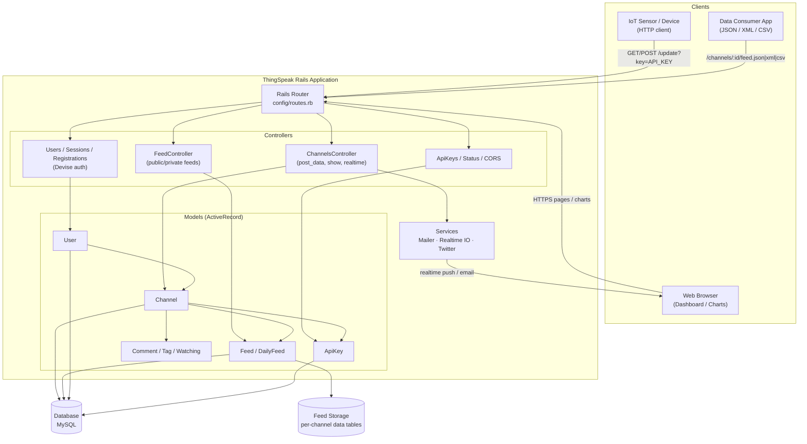

# ThingSpeak — Block Diagram

High-level architecture of the ThingSpeak IoT application (Rails 4 / Ruby).

## Key Blocks

| Block | Responsibility | Location |
|---|---|---|
| Router | Maps `/update`, `/channels`, `/feeds` URLs | `config/routes.rb` |
| ChannelsController | Data ingest (`post_data`), channel CRUD, realtime | `app/controllers/channels_controller.rb` |
| FeedController | Serves stored data as JSON/XML/CSV | `app/controllers/feed_controller.rb` |
| Channel model | 8 data fields + location + elevation per entry | `app/models/channel.rb` |
| Feed / DailyFeed | Entry storage & retrieval, timescaling, averaging | `app/models/feed.rb` |
| ApiKey | Read/write key management per channel | `app/models/api_key.rb` |
| User + Devise | Accounts, sessions, registrations | `app/models/user.rb` |
